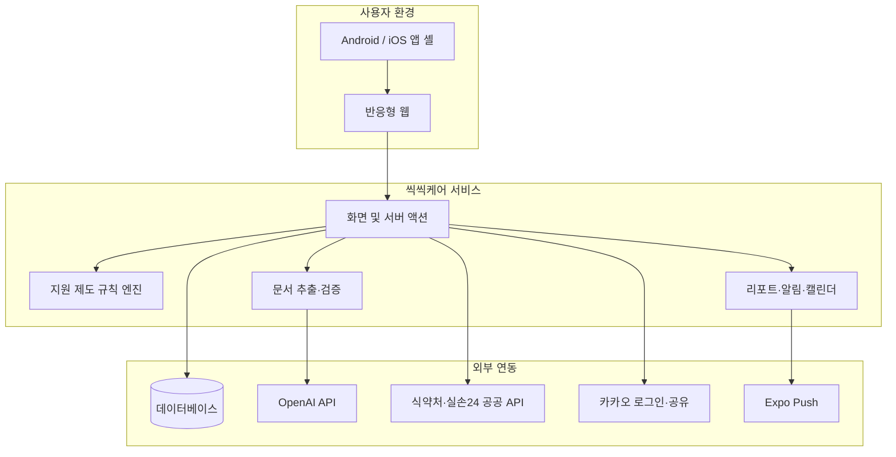

# 씩씩케어 (BraveCare)

> 퇴원 전 준비부터 회복 기록과 정기 외래까지, 환자와 가족이 함께 관리하는 회복·돌봄 협업 서비스

[웹 서비스](https://bravecare-kr.vercel.app) · [Android APK 받기](https://github.com/kwon-dohun/bravecare/releases/latest)

> Android는 APK로 직접 설치해 사용한다. Google Play·App Store에는 아직 출시하지 않았으며, iOS 사용자는 웹 서비스를 이용한다.

## 소개

퇴원은 치료의 끝이 아니라 일상 회복의 시작이다. 하지만 환자와 가족은 퇴원 안내문, 병원 문자, 약봉투, 외래 일정, 보험 서류, 공공 지원 정보, 가족 간 역할 분담을 동시에 관리해야 한다.

**씩씩케어**는 이처럼 흩어진 정보를 하나의 회복 흐름으로 정리한다. 환자의 상황에 맞춰 지원 제도와 할 일을 안내하고, 병원 문서에서 필요한 정보를 추출하며, 가족이 업무를 나누고, 매일의 회복 상태를 외래 리포트로 이어 준다.

## 핵심 기능

### 맞춤형 퇴원 시작

- 입원 사유, 퇴원일, 출생연도, 거주 지역, 낮 시간 돌봄 상황, 소득 구간을 묻는 간결한 온보딩
- 퇴원일이 미정이어도 `퇴원 3일 전`, `퇴원 당일` 같은 상대 일정으로 안내
- 독거 환자가 직접 사용하는 **셀프 케어 모드**와 가족 공동 관리 모드 제공
- 퇴원일이 확정·변경되면 상대 일정만 다시 계산하고, 사용자가 직접 등록한 일정은 유지

### 공공 지원과 신청 관리

- 연령, 지역, 소득, 입원 사유, 돌봄 상황을 바탕으로 공공 지원 제도 47개(전국·광역 26개 + 시·군·구 21개)를 규칙 기반으로 판정
- `가능성 높음`, `확인 필요`, `해당 없음`으로 결과를 구분하고 판정 근거·신청 방법·필요 서류·출처를 표시
- 신청 마감과 상태를 관리하고, 지원 제도를 바로 할 일로 전환
- 실손24 참여 요양기관을 검색하고, 필요한 보험 청구 서류를 정리

### 병원 문서·문자 정리

- 퇴원 안내문, 약봉투, 영수증, 진단서·확인서, 병원 문자에서 일정과 준비 항목을 추출
- 사진이 흐리거나 병원 서류가 아닌 경우 재촬영을 안내
- AI 결과를 자동 확정하지 않고 사용자가 검토·수정한 항목만 일정과 할 일로 반영
- 원본 사진은 저장하지 않고, 필요한 텍스트만 보관 (글자 인식을 위해 사진을 OpenAI API로 전송하며, 이는 개인정보처리방침에 고지)

### 가족 공동 돌봄

- 7일간 유효한 링크 또는 QR 코드로 가족을 초대
- 할 일 생성, 담당자 배정, 직접 맡기, 완료 처리, 활동 기록 확인
- 환자 전용 안부 링크를 통해 앱 설치 없이 당일 상태를 기록 가능
- 가족 활동은 모바일 푸시 알림으로 공유하고, 일정은 `.ics` 캘린더 파일로 내보내기 가능

### 데일리 체크와 외래 리포트

- 복약, 체온, 통증, 부작용, 수술 부위 이상, 배변 상태를 매일 기록
- 누적 기록을 기반으로 통증 변화, 복약 기록, 의료진에게 물어볼 질문을 외래용 리포트로 정리
- 회복이 안정되면 데일리 체크를 종료하고 필요할 때 다시 시작

### 근거 중심 돌봄 챗봇

- 저장한 병원 문서, 우리 집 일정·할 일·지원 정보, 쉬운 용어 사전을 우선 근거로 답변
- 인용한 근거 문장이 실제 자료에 있는지 코드로 다시 확인
- 처방 변경, 복약 중단, 진단 같은 의료 판단은 하지 않도록 제한
- 응급 증상·위기 표현은 일반 답변보다 119 또는 109 안내를 우선
- 식약처 의약품 허가정보와 DUR 정보를 활용해 약물 확인이 필요한 지점을 안내

## 서비스 흐름


## 시스템 구성



## 기술적 핵심

| 영역 | 구현 방식 |
| --- | --- |
| 지원 추천 | AI가 아닌 결정론적 규칙 엔진으로 대상 가능성을 판정하고, 불확실한 조건은 `확인 필요`로 표시 |
| 문서 AI | 구조화된 JSON 응답, 원문 대조 검증, 날짜 모호성 처리, 사용자 확인 단계를 결합 |
| 챗봇 안전성 | 문서 기반 답변, 인용문 재검증, 응급·위기 표현의 사전 분기, 의료 판단 금지 규약 적용 |
| 약물 정보 | 식약처 허가정보·e약은요·DUR 데이터를 활용해 병용금기·효능군 중복·노인주의 확인 지원 |
| 개인정보 | 원본 사진 미저장, 주민등록번호 뒷자리 마스킹, 비활성 케이스 자동 파기, 전체 삭제 지원 |
| 가족 협업 | 만료되는 초대 링크, 활동 기록, 기기 예약 알림과 가족 활동 푸시 알림 제공 |

## 프로젝트 구조

```text
bravecare/
├── app/                 # 페이지, API Route, Server Actions
│   ├── start/           # 온보딩
│   ├── c/[token]/       # 케이스별 회복 관리 화면
│   ├── p/[token]/       # 환자 전용 안부 화면
│   ├── j/[share]/       # 가족 초대 화면
│   ├── api/             # 스캔, 알림, 카카오, 실손24, 자동 파기 API
│   └── ics/             # 캘린더 파일 생성
├── components/          # 재사용 UI 컴포넌트
├── lib/                 # 지원 규칙, 문서 검증, 챗봇, 리포트, 알림 등 핵심 로직
├── mobile/              # Expo 기반 앱 셸
├── supabase/schema.sql  # 데이터베이스 스키마
└── public/              # 정적 자산
```

## 주요 외부 연동

| 서비스 | 용도 |
| --- | --- |
| OpenAI API | 병원 문서·문자 추출, 근거 중심 챗봇 |
| 식약처 의약품 제품 허가정보·e약은요·DUR | 약물 정보 및 안전 확인 |
| 실손24 참여 요양기관 공공 API | 병원별 전산 청구 참여 여부 검색 |
| Supabase | 케이스, 가족, 할 일, 문서 텍스트, 데일리 기록 저장 |
| 카카오 | 계정 연결을 통한 케이스 되찾기 및 초대 링크 공유 |
| Expo Push | 가족 활동 알림과 모바일 푸시 |

## 시작하기

### 요구 사항

- Node.js 20 이상
- npm
- Supabase 프로젝트
- OpenAI API 키: 문서 인식·챗봇 사용 시 필요

### 웹 서비스 실행

```bash
git clone https://github.com/kwon-dohun/BraveCare.git
cd BraveCare
npm install
```

프로젝트 루트에 `.env.local` 파일을 만들고 필요한 값을 설정한다.

```bash
# 필수
NEXT_PUBLIC_SUPABASE_URL=your-supabase-url
SUPABASE_SERVICE_ROLE_KEY=your-service-role-key

# AI 기능 사용 시
GPT_API_KEY=your-openai-api-key

# 선택: 기본값은 챗봇 gpt-4o, 문서 인식 gpt-4.1-mini
GPT_MODEL=gpt-4o
SCAN_MODEL=gpt-4.1-mini

# 선택: 공공·외부 연동
DATA_GO_KR_KEY=your-data-go-kr-key
SILSON24_SERVICE_KEY=your-silson24-key
KAKAO_REST_KEY=your-kakao-rest-key
KAKAO_CLIENT_SECRET=your-kakao-client-secret
NEXT_PUBLIC_KAKAO_JS_KEY=your-kakao-js-key

# 선택: 운영·배포
CRON_SECRET=your-cron-secret
NEXT_PUBLIC_CONTACT_EMAIL=contact@example.com
NEXT_PUBLIC_PLAY_URL=https://play.google.com/...
NEXT_PUBLIC_APPSTORE_URL=https://apps.apple.com/...
ANDROID_CERT_SHA256=your-android-cert-sha256
APPLE_TEAM_ID=your-apple-team-id
```

Supabase 프로젝트에서 [`supabase/schema.sql`](./supabase/schema.sql)을 실행한 뒤 개발 서버를 시작한다.

```bash
npm run dev
```

브라우저에서 [http://localhost:3000](http://localhost:3000)을 연다.

### 모바일 앱 실행

```bash
cd mobile
npm install
npx expo start
```

문서 스캐너와 기기 알림은 네이티브 모듈을 사용하므로 Expo Go 대신 개발 빌드 또는 EAS 빌드를 사용한다.

```bash
# Android 개발 빌드
npx expo run:android

# 내부 배포용 APK
npx eas-cli@latest build --platform android --profile preview

# 스토어 제출용 Android App Bundle
npx eas-cli@latest build --platform android --profile production
```

## 테스트

```bash
npm test
```

자동 테스트 106개가 지원 제도 판정, 문서 추출 검증, 챗봇 근거 검증, 약물 DUR 확인, 알림, 반복 할 일, 캘린더 파일, 외래 리포트 등을 다룬다.

## 개인정보와 의료 안전 원칙

- 서비스는 의료 진단·처방·복약 변경을 제공하지 않는다.
- AI 결과는 사용자 확인 전에는 일정이나 할 일로 확정되지 않는다.
- 병원 문서의 원본 이미지는 보관하지 않는다. 글자 인식을 위한 OpenAI 전송은 개인정보처리방침에 고지한다.
- 식별 가능 정보는 저장 전에 마스킹한다.
- 환자 전용 링크는 일일 안부 기록 범위로 접근을 제한한다.
- 초대 링크는 만료되며 재발급할 수 있다.
- 마지막 활동 후 365일이 지난 케이스를 자동 파기하도록 구성했다.

## 저작권

이 저장소의 코드는 오픈소스가 아니며, 모든 권리는 저작자에게 있다. 서비스가 사용하는 오픈소스와 공공데이터의 라이선스는 [오픈소스 라이선스](https://bravecare-kr.vercel.app/licenses) 화면에 고지한다.

## 배포

- 웹: [bravecare-kr.vercel.app](https://bravecare-kr.vercel.app)
- Android APK: [GitHub Releases](https://github.com/kwon-dohun/bravecare/releases/latest)

## 기여 및 문의

버그 제보와 기능 제안은 [Issues](https://github.com/kwon-dohun/BraveCare/issues)를 이용해 줘.
