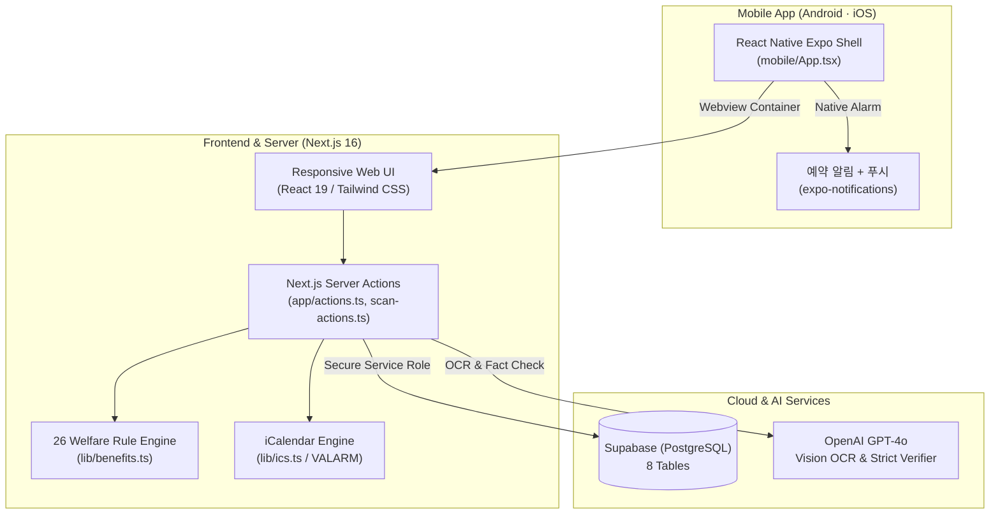

# 씩씩케어 (BraveCare)

> 수술·입원 후 퇴원 골든타임부터 정기 외래까지, 맞벌이 가족을 위한 회복 관리 및 역할 분담 플랫폼

<p align="left">
  
  
  
  
  
  
  
  
</p>

- 웹 서비스 링크: [https://bravecare-kr.vercel.app](https://bravecare-kr.vercel.app)
- 안드로이드 앱 다운로드: [GitHub Releases (APK)](https://github.com/kwon-dohun/bravecare/releases/latest)
- iOS 앱: 출시 준비 중입니다. 앱스토어 등록 전까지는 웹 서비스를 이용해 주세요.
- 기획 문서 (PRD v3.6): [BraveCare PRD Notion](https://app.notion.com/p/BraveCare-419575b2d5528070b2dcd256a85e373c)
- 모바일 앱 프로젝트: `mobile/` (React Native Expo 앱 셸, Android·iOS)

---

## 1. 프로젝트 개요

병원은 보통 퇴원 전날(D-1) 오후나 당일 아침에 갑작스럽게 퇴원을 통보합니다. 경황이 없는 환자와 맞벌이 보호자는 원무과 필수 서류, 공공 복지 지원, 퇴원 후 간병 분담 계획을 세우지 못한 채 혼란을 겪습니다.

씩씩케어(BraveCare)는 회원가입 없이, 단 5문항의 온보딩으로 가족이 받을 수 있는 26종 복지 혜택과 퇴원 타임라인을 매칭하고, 가족 간 역할을 링크 하나로 분담하여 정기 외래 완치까지 함께 회복을 돕는 모바일 헬스케어 플랫폼입니다.

---

## 2. 핵심 기능

### 2.1. 5문항 온보딩 및 2026 복지 룰 엔진
- **경량 온보딩**: 입원 사유, 퇴원일(미정 허용), 연령 및 거주지, 낮 시간 돌봄 공백, 대략의 소득 구간만 입력받습니다.
- **26종 공공 복지 매칭**: 2026년 보건복지부·지자체 가이드라인을 기반으로 '대상 가능성 높음', '소득 확인 필요', '해당 없음'을 결정론적으로 판정합니다.
- **퇴원 필수 서류 체크**: 실손24 지원 여부 기록 및 퇴원 시 챙겨야 할 원무과 서류 4종을 점검합니다.

### 2.2. 퇴원 타임라인 및 스마트 캘린더 연동 (.ics)
- **4단계 회복 사이클**: 퇴원 전 준비 -> 퇴원 당일 -> 집에서 회복 및 첫 외래 -> 정기 외래 및 재활
- **퇴원일 미정 처리**: 날짜가 확정되지 않은 경우 상대 일정(예: '퇴원 3일 전')으로 안내하며, 날짜 확정 시 전체 일정을 자동으로 재계산합니다.
- **개인정보 없는 스마트 캘린더**: 전화번호를 수집하지 않으며, 맡은 역할을 `.ics` 파일로 내려받아 캘린더에 전날 20:00 및 당일 08:30 이중 알람(VALARM)을 등록합니다. 시간이 있는 일정은 하루 전과 1시간 전에 울립니다.
- **가족 돌봄 캘린더**: 날짜별 할 일·퇴원일·미신청 지원 마감을 색 점으로 보여주고, 그 자리에서 체크·분담·추가합니다.
- **시간과 반복**: 할 일에 시간(외래 오후 2시)과 반복(매일 소독, 매주 재활)을 붙일 수 있고, 반복 할 일은 끝낼 때 다음 회차가 생깁니다.

### 2.3. 무가입 가족 역할 분담 (Capability URL)
- 카카오톡 단톡방 등에 공유 링크(7일 유효)를 전송하면, 다른 가족은 이름만 입력하고 즉시 참여합니다. 앱이 깔려 있으면 링크가 앱으로 열립니다.
- **가족 모두 같은 권한**: 참여한 가족도 처음 만든 사람과 똑같은 5개 탭 화면(`/c/<구성원 ID>`)을 씁니다. 예외는 전체 삭제(처음 만든 가족만)와 내보내기(처음 만든 가족은 내보낼 수 없음)뿐이고, 참여한 가족은 스스로 나갈 수 있습니다.
- **새 소식**: 가족이 맡거나 끝낸 일을 날짜별로 모아 보고, 안 본 소식은 홈의 종 아이콘에 표시됩니다.
- **카카오로 되찾기**(선택): 카카오 계정을 연결해 두면 휴대폰을 바꿔도 내 주소를 다시 찾습니다. 카카오 회원번호만 저장합니다.

### 2.4. 비전 AI 서류 스캔 및 환각 차단 챗봇
- 퇴원 안내문, 약봉투, 영수증 사진(최대 3장) 및 병원 알림톡 문자를 분석하여 진료 일정과 할 일을 자동 추출합니다.
- **원문 일치 검증 파이프라인**: AI의 의료 판단을 배제하며, 추출된 텍스트 원문에 실제로 존재하는 문장만 할 일로 등록됩니다.
- 응급 키워드가 감지되면 119 긴급 안내를 최우선으로 제공합니다.

### 2.5. 일일 안부 체크 및 진료실 외래 리포트
- **일일 안부 체크**: 복약 여부, 체온, 통증 점수(0~10), 배변 상태를 하루 1회 간편하게 기록합니다.
- **진료실 외래 리포트**: 외래 진료 시 의료진에게 화면을 가로로 돌려 보여줄 수 있는 단일 요약 리포트를 제공합니다.

### 2.6. 네이티브 앱 셸 (`mobile/`)
화면은 웹 한 벌을 그대로 보여주고, 앱만 할 수 있는 일만 맡습니다.
- **알림**: 매일 저녁 8시 안부 체크, 내가 맡았거나 담당자 없는 할 일의 전날 저녁·당일, 미신청 지원의 마감 3일 전·당일을 휴대폰에 예약합니다(서버 없이 제시간에 울림). 가족이 일을 맡거나 끝내면 푸시로 알립니다.
- **앱 링크**: 초대 링크(`/j/…`)와 내 화면 링크(`/c/…`)를 앱으로 엽니다.
- **외래 리포트 밝기**: 리포트를 여는 동안 화면을 가장 밝게 합니다.
- **문서 스캐너**: 가장자리를 찾아 반듯하게 잘라 주는 휴대폰 문서 스캐너로 서류를 찍습니다.
- **공유창·오프라인 화면**: 초대 링크를 휴대폰 공유창으로 보내고, 인터넷이 끊기면 안내 화면을 보여줍니다.

---

## 3. 시스템 아키텍처



---

## 4. 디렉터리 구조

```text
bravecare/
├── app/                      # Next.js 16 App Router (페이지 및 서버 액션)
│   ├── actions.ts            # 케이스·가족·할 일·지원·안부 서버 액션
│   ├── scan-actions.ts       # 서류 글자 옮겨 적기·검증·챗봇 서버 액션
│   ├── start/                # 5문항 온보딩 위저드
│   ├── c/[token]/            # 모든 가족이 쓰는 화면. 토큰은 케이스 토큰(처음 만든 사람) 또는 구성원 ID(참여한 가족)
│   │                         #   홈 · calendar · chat · tasks · more(전체) / benefits · family · daily · report
│   │                         #   · docs · scan · glossary · help · news · settings
│   ├── j/[share]/            # 가족 초대 진입 경로
│   ├── m/[id]/               # 예전 가족 주소. /c/<구성원 ID>로 보낸다
│   ├── ics/                  # 할 일 .ics 캘린더 파일
│   ├── api/quick-check/      # 앱 알림 원터치 안부 기록
│   ├── api/app/              # 앱: 푸시 토큰 등록 + 예약할 알림 목록
│   ├── api/kakao/            # 카카오 로그인(되찾기) 시작·콜백
│   ├── .well-known/          # 앱 링크 확인 파일 (Android assetlinks, iOS AASA)
│   └── privacy/, terms/      # 개인정보처리방침·이용약관 (초안)
├── components/               # 재사용 UI (Nav, TaskList, Sheet, Mascot, Icon, InviteButton …)
├── lib/                      # 핵심 로직 (순수 함수는 *.test.ts로 테스트)
│   ├── benefits.ts           # 복지 룰 엔진 + 제도 5종
│   ├── benefit-list.ts       # 나머지 제도 21종 (합계 26종)
│   ├── timeline.ts           # 4단계 타임라인 템플릿, 반복 할 일의 다음 날짜
│   ├── calendar.ts           # 달력 일정 모으기
│   ├── reminders.ts          # 앱이 예약할 알림 목록
│   ├── push.ts               # 가족 활동 기록 + 푸시
│   ├── brief.ts, glossary.ts, task-help.ts  # 챗봇 자료, 쉬운 용어 사전, '왜 해요?'
│   ├── report.ts             # 외래 리포트 집계
│   ├── ics.ts                # 캘린더 .ics 알람 생성기
│   ├── extract.ts, chat.ts   # 서류 추출·챗봇의 원문 대조 검증
│   └── app.ts                # 웹 ↔ 앱 통로 (밝기·스캐너·공유)
├── mobile/                   # Expo 앱 셸
│   ├── App.tsx               # 웹뷰 + 알림·앱 링크·밝기·스캐너·공유
│   ├── app.json, eas.json    # 앱 설정, 빌드 설정
│   └── assets/               # 씩씩이 아이콘
├── docs/store-listing.md     # 스토어 등록 문구·개인정보 신고 답안
├── supabase/schema.sql       # 테이블 정의
└── README.md
```

---

## 5. 설계 및 보안 원칙

- **AI의 의료 판단 배제**: 서류 추출과 챗봇 모두 모델의 자유 생성을 제한하며, 원문 텍스트에 실제 존재하는 문장만 통과시킵니다(`verifyItems`, `verifyAnswer`).
- **사진 미저장 (Privacy-by-Design)**: 주민등록번호 뒷자리는 마스킹되며, 원본 사진은 서버에 저장하지 않고 파싱된 텍스트만 보관하여 유출 위험을 차단합니다.
- **결정론적 룰 엔진**: 복지 제도는 AI의 추론이 아닌 투명한 검증 규칙표(`lib/benefits.ts`)로만 판정합니다. 소득을 모를 경우 불이익 없이 '소득 확인 필요'로 분류합니다.
- **무가입 Capability Token**: 회원가입 절차 없이 난수 토큰 기반의 URL(`/c/<토큰>`, `/j/<토큰>`) 자체가 접근 보안 키 역할을 수행합니다.

---

## 6. 개발 및 실행 가이드

### 6.1. 웹 서비스 (Web)

```bash
# 종속성 설치
npm install

# 환경 변수 설정 (.env.local)
# NEXT_PUBLIC_SUPABASE_URL=your-supabase-url
# SUPABASE_SERVICE_ROLE_KEY=your-service-role-key
# GPT_API_KEY=your-openai-api-key
# (선택) 아래 값이 없으면 해당 기능의 버튼이 보이지 않습니다
# KAKAO_REST_KEY=            카카오 로그인(되찾기). KAKAO_CLIENT_SECRET은 카카오 콘솔에서 켰을 때만
# NEXT_PUBLIC_KAKAO_JS_KEY=  카카오톡 공유 버튼
# NEXT_PUBLIC_CONTACT_EMAIL= 도움말의 문의하기
# NEXT_PUBLIC_PLAY_URL= / NEXT_PUBLIC_APPSTORE_URL=   초대 화면의 '앱 받기'
# ANDROID_CERT_SHA256= / APPLE_TEAM_ID=               앱 링크 확인 파일

# 개발 서버 실행
npm run dev
```

### 6.2. 모바일 앱

```bash
cd mobile
npm install

# 문서 스캐너·밝기 같은 네이티브 모듈이 있어 Expo Go로는 안 됩니다. 개발 빌드나 EAS 빌드를 쓰세요.
npx expo run:android                                   # 로컬 개발 빌드
npx eas-cli@latest build -p android --profile preview  # APK
npx eas-cli@latest build -p ios --profile production   # iOS (애플 개발자 계정 필요)
```

### 6.3. 단위 테스트

```bash
# 복지 판정, 타임라인·리포트·.ics, 서류 검증, 달력, 챗봇 자료, 알림 예약, 반복 할 일 등 40개 테스트
npm test
```

---

### 6.4. 출시 전에 사람이 해야 하는 설정

코드는 들어가 있고, 아래 값을 넣어야 켜집니다.

| 할 일 | 어디서 | 넣을 곳 |
| :--- | :--- | :--- |
| 카카오 앱 등록 (로그인·공유) | developers.kakao.com → 앱 만들기 → 카카오 로그인 켜기, Redirect URI `https://bravecare-kr.vercel.app/api/kakao/callback`, Web 플랫폼 도메인 등록. 동의 항목은 아무것도 고르지 않음(회원번호만 씀) | Vercel 환경 변수 `KAKAO_REST_KEY`, `NEXT_PUBLIC_KAKAO_JS_KEY` |
| Android 앱 링크 | `npx eas-cli@latest credentials`에서 SHA-256 지문 확인 (Play 앱 서명을 쓰면 Play Console의 지문도) | Vercel `ANDROID_CERT_SHA256` |
| Android 푸시 | Firebase 프로젝트 → `google-services.json`을 `mobile/`에 두고 `app.json`의 `android.googleServicesFile` 지정, FCM 키를 EAS에 등록 | EAS |
| iOS 빌드·푸시·링크 | 애플 개발자 계정(연 99달러). 팀 ID | Vercel `APPLE_TEAM_ID`, EAS |
| 스토어 등록 | `docs/store-listing.md`의 문구와 개인정보 신고 답안 | Play Console, App Store Connect |
| 스토어 주소 | 출시 뒤 | Vercel `NEXT_PUBLIC_PLAY_URL`, `NEXT_PUBLIC_APPSTORE_URL` |
| 방침·약관의 [작성 필요] | 시행일, 보호책임자, 장기 미사용 파기 기간. 개인정보보호위원회 작성 도구로 대조 | `app/privacy`, `app/terms` |

푸시 설정 전에도 예약 알림(할 일·지원 마감·저녁 안부)은 동작합니다. 가족 소식 푸시만 설정 뒤에 옵니다.

---

## 7. 기획서(PRD v3.6) 대비 구현 내역

| 항목 | 기획서 (PRD 초안) | 실제 구현 (Production) | 엔지니어링 의사결정 사유 |
| :--- | :--- | :--- | :--- |
| 앱 아키텍처 | React Native 네이티브 컴포넌트 이원화 | Next.js 웹 코어 + Expo 네이티브 셸 | 단일 코드베이스로 빠른 UI 개선과 스토어 심사 없는 즉시 업데이트 보장 |
| 권한 관리 | Supabase Auth + RLS | Server Actions + Capability Token (+ 카카오로 되찾기) | 무가입 환경에 맞춰 공개 키 접근을 차단하고 서버 액션에서 안전하게 검증 |
| 전체 삭제 | 가족 모두 같은 권한 | 처음 만든 가족만 | 되돌릴 수 없는 일이라 한 사람에게만. 참여한 가족은 '나가기' |
| 알림 | 앱 푸시로 통일 | 휴대폰 예약 알림 + 가족 소식만 서버 푸시 | 예약 알림은 푸시 서버·시간 지연 없이 정시에 울림 |
| 오류 수집·사용 분석 | Sentry·Amplitude | 아직 붙이지 않음 | 실제 사용자가 생길 때 트래킹 플랜을 정하고 붙임 |
| 서류 보관 | 암호화 스토리지 버킷 | 텍스트만 추출 후 원본 즉시 폐기 | 의료 서류 사진 유출 위험을 원천 차단하는 Privacy-by-Design 달성 |
| 복지 제도 | 기획 25종 | 공식 출처 재검증 26종 | 2026년 상병수당, 서울형 입원비 등 정부 공고 변경 사항을 전수 정밀 반영 |

---

## 8. 라이선스

This project is licensed under the MIT License.
